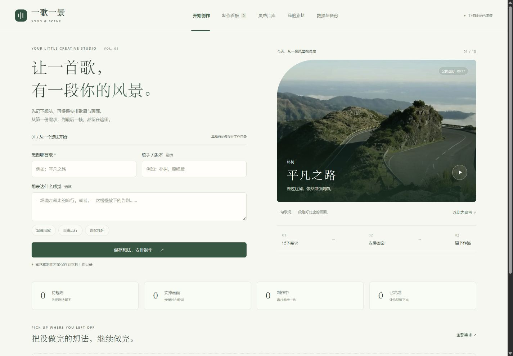
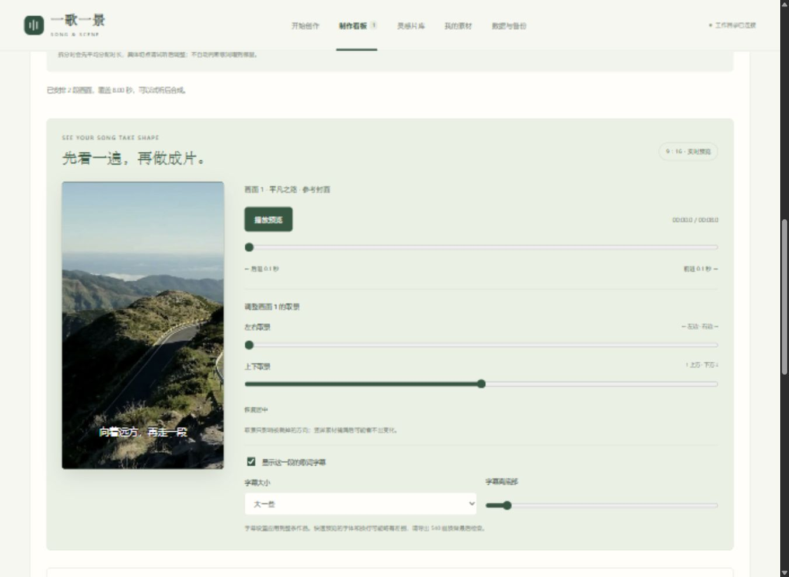

# 一歌一景 · Song & Scene V8

把一首歌、一点心情，慢慢做成一段属于自己的风景。

一个在自己电脑上运行的歌曲短片工作台。首页只填歌名、歌手和感觉；进入详情后选音乐、逐句安排图片或视频，边听边看预览，最后在本机合成并归档作品。



## 下载与打开

前往 [V8 下载区](https://github.com/Hgb-2005/song-scene/releases/tag/v8.0.0)。Windows 10/11 64 位推荐安装版：

| 文件 | 内容 |
| --- | --- |
| SongScene-v8-Windows-Setup.exe | 桌面安装版，包含 Python，创建快捷方式，无需终端 |
| SongScene-v8-Windows-Portable.zip | 免安装桌面版，解压后打开 SongScene.exe，保留旁边的 _internal 目录 |
| SongScene-v8-full.zip | 全部源码、文档、十条高清样片与十条轻量预览 |
| SongScene-v8-light.zip | 全部源码、文档与十条轻量预览 |
| SongScene-v8-source.zip | 源码、封面、文档与测试，不含 MP4 |

桌面版检测本机视频引擎；缺少时首次自动从上游下载约 109 MB，并校验固定版本，以后可离线制作。安装包尚未代码签名；目前只在本机 Windows 和 Chromium 上实际验收，未声称适配所有电脑。详见 [安装与第一次创作](docs/V8-安装与使用.md)。

桌面数据保存在 `%LOCALAPPDATA%\SongScene\data`，安装新版和卸载程序都会保留。页面“数据与备份”可查看位置，导出含媒体的完整 ZIP。V7 用户通过完整备份导入 V8，原目录保留。

## V8 新增

- **实时制作预览**：歌曲作为播放时钟，按段切换图片或视频、叠歌词；可拖动进度、0.1 秒微调、定位某段。
- **取景调整**：每段独立调整左右、上下裁切，预览和输出使用相同取景坐标。
- **字幕设置**：开关、大小、距底部位置作用于整条作品，随方案保存、备份和恢复。
- **桌面启动管理**：打开页面、查看数据文件夹，重复启动复用实例，退出时提示取消未完成合成。

快速预览采用浏览器解码，字体、换行可能与 FFmpeg 成片有差异，请先导出 540 画质检查。不支持浏览器播放的素材会显示提示。



## 制作流程

```text
记下需求 → 选择歌曲片段 → 安排歌词与画面 → 播放预览并调整 → 本机合成 → 自动归档
```

支持 0.2–120 秒片段、540×960 / 1080×1920 MP4、真实进度与取消、成片导入、个人素材库、情绪浏览和收藏。需求按待规划 / 安排画面 / 制作中 / 已完成管理，可归档恢复。

数据使用 SQLite，旧窗口不会悄悄覆盖新修改；保留最近 30 份记录快照，完整备份可预览冲突后恢复。制作任务包包含 JSON、文字说明、SRT 和用到的素材，兼容 V6 迁移。

歌曲、画面和歌词时间由使用者提供、确认；不联网找歌，不自动识别歌词唱到哪里，不调用收费生成模型。私人记录和新增素材不会自动上传 GitHub。

## 从源码运行与检查

Python 3.10+，媒体功能需要 FFmpeg/FFprobe，无需 pip 或 npm 运行时依赖。

```text
python app.py --open
python tools/check.py
python -m unittest discover -s tests -v
node --test tests/timeline.test.mjs tests/composition.test.mjs
```

源码模式默认使用程序目录的 data/，可用 --data-dir 指定位置。源码模式与桌面模式的数据位置不同，迁移请使用完整备份。

V8 本机通过 14 项 Python 测试、7 项前端契约测试，包含实际裁切、字幕配置、视频循环、高清合成、备份恢复、实例锁及引擎校验/取消。GitHub Actions 持续运行这些检查。

## 文档与素材

- [安装与使用](docs/V8-安装与使用.md)
- [V8 改动与验收](docs/V8-升级与验收.md)
- [五人首次使用测试表（待真实执行）](docs/V8-首次使用测试.md)
- [架构与参考](docs/架构与参考.md)
- [开发与 Windows 打包](CONTRIBUTING.md)
- [第三方工具与媒体说明](THIRD_PARTY_NOTICES.md)
- 十条高清原片：[`视频/`](视频/)，轻量版：[`网页预览/`](网页预览/)，来源：[`素材署名/`](素材署名/)
- [V7 历史版本](https://github.com/Hgb-2005/song-scene/releases/tag/v7.0.0)

当前未指定统一开源许可证，代码和媒体的使用范围请分别确认。源码和样片在仓库，安装包和现成 ZIP 在 Releases。
