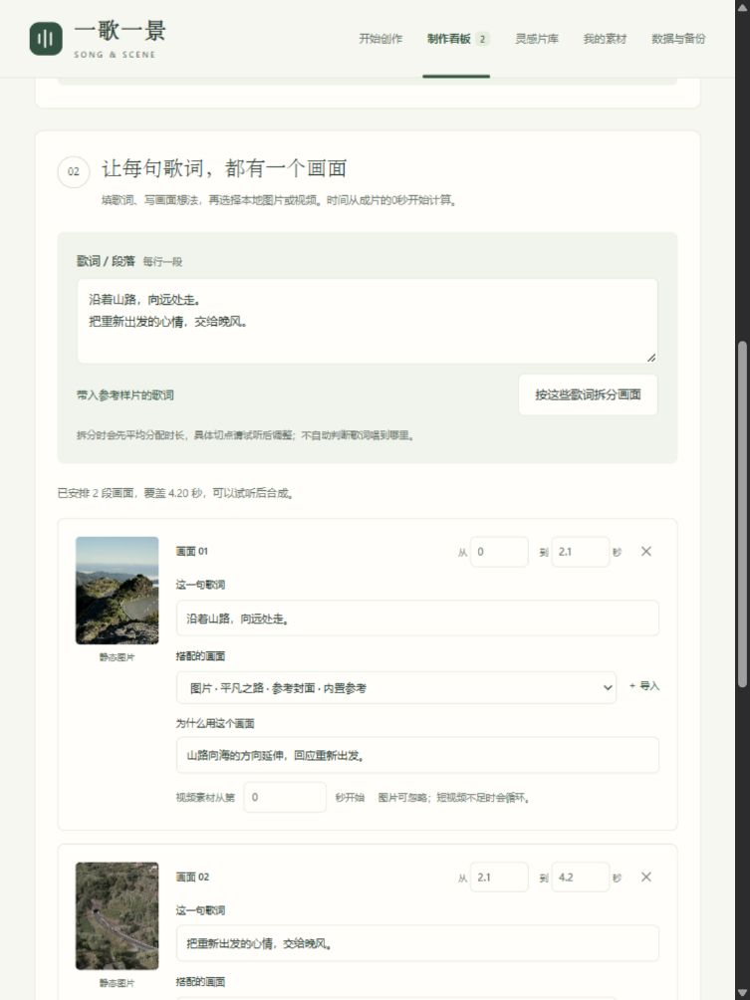

# 一歌一景 · Song & Scene

把一首歌、一点心情，慢慢做成一段属于自己的风景。

一歌一景是一个在自己电脑上运行的歌曲短片工作台。首页只填歌名、歌手和感觉；进入制作详情后，再选择音乐片段、逐句安排图片或视频，最后在本机合成并归档作品。


## 下载与启动

前往 [V7 Releases 下载区](https://github.com/Hgb-2005/song-scene/releases/tag/v7.0.0)：

| 文件 | 内容 |
| --- | --- |
| SongScene-v7-full.zip | 完整程序、十条高清样片、十条轻量预览，约212 MiB |
| SongScene-v7-light.zip | 完整程序与十条轻量预览，约34 MiB |
| SongScene-v7-source.zip | 完整源码、封面、文档与测试，不含MP4，约4 MiB |

Windows解压后双击 **启动工作台.bat**。需要Python 3.10+；音视频识别、自动封面和本机合成需要已安装FFmpeg及FFprobe。日常运行无需pip或npm安装。

```text
python app.py --open
```

默认打开 `http://127.0.0.1:8866/index.html`。保持服务窗口运行。数据存在程序目录的 `data/` 文件夹中，不进入本仓库。

## 能做什么

- **制作看板**：待规划、安排画面、制作中、已完成；需求归档后可以恢复。
- **歌曲选段**：导入本地歌曲或带声音的视频，试听并选择0.2—120秒片段。
- **逐句配画面**：为每段歌词或文案设置时间、图片或视频、素材起点和画面想法。
- **真实本机合成**：输出540×960或1080×1920 MP4，可叠歌词、显示实际进度、取消和重试。
- **成片归档**：合成后自动进入个人片库、关联需求；也能导入其他软件完成的视频。
- **个人素材库**：导入音乐、图片与视频，自动识别信息；相同内容复用，不移动原文件。
- **可靠保存**：磁盘数据库、版本冲突保护、最近30份记录快照、含媒体的完整ZIP备份和恢复预览。
- **旧版迁移**：支持V6备份及原浏览器记录迁移。

程序按你选择的音乐、画面和时间方案工作，不联网找歌或找素材，也不自动识别歌词演唱时间。



## 制作流程

```text
记下需求 → 选择歌曲片段 → 安排歌词与画面 → 本机合成 / 导入成片 → 自动归档
```

可导出制作任务包，包含JSON方案、文字说明、SRT歌词时间轴和用到的素材，供后续人工制作使用。

## 样片与截图

- 十条原有高清视频：[`视频/`](视频/)
- 十条轻量预览：[`网页预览/`](网页预览/)
- 本机实际生成的4.2秒验收视频：[`examples/local-render-check.mp4`](examples/local-render-check.mp4)
- 所有界面截图：[`docs/previews/`](docs/previews/)
- 素材与作者记录：[`素材署名/`](素材署名/)

验收截图中的示例需求不是程序内置的个人记录；首次运行的私人工作目录为空白。程序不会把你的新需求或导入素材自动上传到GitHub。

## 开发检查

```text
python tools/check.py
python -m unittest discover -s tests -v
node --test tests/timeline.test.mjs
```

V7本机验收通过9项后端集成测试和3项时间轴测试，覆盖实际视频合成、高清输出、任务取消、磁盘重启、版本冲突和完整备份恢复。仓库配置了GitHub Actions。

## 文档

- [完整使用说明](README-先看这里.md)
- [升级与验收说明](升级与验收说明.md)
- [架构与参考项目](docs/架构与参考.md)
- [开发维护](CONTRIBUTING.md)
- [代码、工具与素材使用说明](THIRD_PARTY_NOTICES.md)

源码、图片与原始样片保存在仓库；三个现成交付ZIP位于Releases，以避免把大型打包文件重复放进Git历史。当前未指定统一开源许可证，代码和媒体的使用范围请分别确认。
